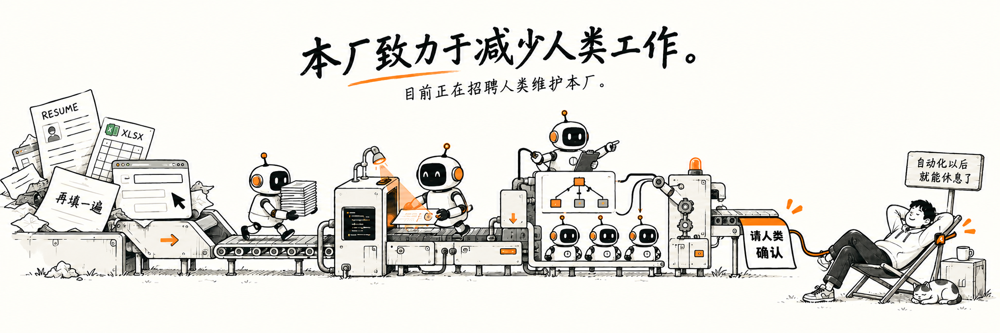

<div align="center">

<samp>HUMAN-IN-THE-LOOP · 人类暂未下线</samp>

# 人类待办消灭计划

**你好，我是筱哲。我负责提出需求、写代码，以及给大肥鱼收拾残局。**

把重复劳动交给程序，把不确定性交给 AI。  
最后的确认按钮，留给人类。

[大肥鱼与 Agent ↓](#大肥鱼与-agent) · [求职工具 ↓](#求职工具) · [AI 制作 Live2D](https://github.com/XiaoZheBrother/live2d-production-notes) · [看大肥鱼的 B 站](https://space.bilibili.com/338156319)

</div>

---

```text
$ whoami
一个遇到重复操作，会先想「能不能写个工具」的人。

$ cat current-task.txt
原始需求：少填几遍简历，养一只会聊天的大肥鱼。
当前进度：求职工作台还在做，鱼已经开始直播、打红警、看动画了。
问题定位：可能对「顺手做一下」的理解存在偏差。
```

## 大肥鱼与 Agent

最近在做一件挺有意思的事：让一个 AI 角色有自己的经历，能使用工具、和人互动，也能回头看看自己做得怎么样。

「筱哲的大肥鱼」是我的实践对象。她在 B 站发视频、回复评论，我们也尝试让她接收直播弹幕、用 Live2D 表演、玩红警和制作动画 reaction。过程中有不少翻车：找不到敌人、建筑放不好、说话赶不上画面，以及看一集动画吃掉太多 Token。

我把其中能复用的部分拆成了 **DeepSeek Harness（DSH）插件**。你可以拿来给自己的**大肥鱼 / Agent** 用，不需要沿用她的名字、人设或账号。

| 项目 | 能给你的大肥鱼 / Agent 带来什么 |
| :--- | :--- |
| [🐟 B 站工作台](https://github.com/XiaoZheBrother/dsh-bilibili-dafeiyu) | 绑定账号，浏览视频、回复评论、发送弹幕，管理互动、创作和成长记录 |
| [🌱 Agent 成长](https://github.com/XiaoZheBrother/dsh-agent-growth) | 从真实素材中学习，自主关注问题、复盘作品，保留来源与记忆修订历史 |
| [🎙️ 直播工作室](https://github.com/XiaoZheBrother/dsh-live-studio) | 接收 B 站弹幕、语音回复、控制内置 Live2D 舞台，记录模型消耗和礼物金额 |
| [🎮 游戏 Agent](https://github.com/XiaoZheBrother/dsh-game-agent) | 用工具观察和操作游戏，接收观众指令、自动续局，记录经验与复盘 |
| [🎬 陪看工作室](https://github.com/XiaoZheBrother/dsh-reaction-studio) | 连续观察剧情，自主选择发言、暂停和表情动作，制作离线 reaction 视频 |

各插件按需组合，安装方式和验证状态以各仓库 README 为准。直播、游戏和陪看目前仍是开发预览；游戏适配器面向项目使用的修改版红警 2 网页接口，Live2D 模型与游戏资源需要自行准备。

[](https://github.com/XiaoZheBrother/dsh-bilibili-dafeiyu)

> 最初只想让她陪我聊两句。后来开始给她修自动续局。

### 🎨 AI 全流程制作 Live2D

除了让角色动起来，我也在记录怎么用 AI 把角色做出来：设计、出图、精修、拆层、原生绑定、动作、换装和 Web 接入。包含失败路线、检查工具与可复用的制作流程，人的视觉确认和官方工具导出也有明确分工。

[阅读制作笔记 →](https://github.com/XiaoZheBrother/live2d-production-notes)

### 最近在继续琢磨

- **自主性**：尽量把能力做成工具，让 Agent 决定什么时候用，而不是给每个场景写死一套行为。
- **经验与记忆**：保留原始经历，让经验可以验证、修订和停用，不把一次总结当作永远正确。
- **表达与陪看**：让观察、理解、发言和表演各司其职；可以沉默，也可以暂停聊几句。
- **成本与可靠性**：减少重复上下文，记录各阶段消耗，让长任务能够从断点继续。

这些仍在通过实际使用验证。视频里会分享接入过程、失败和改进，也欢迎带着自己的 Agent 来试。

## 求职工具

### 🛫 OfferPilot · 你的求职领航员

开源、本地优先的 AI 求职工作台。把投递、简历、模拟面试、复盘和 Offer 对比放到一起，让每次准备都有迹可循。

> 希望 AI 帮我准备面试。它反手给我加了一轮模拟面试。

[查看源码 →](https://github.com/offercontext/offerPilot)

### 🧩 OfferContext · 机会别漏，投递别乱

聚合校招机会，按岗位和城市等条件筛选，把感兴趣的机会与投递进度集中管理。从发现岗位到跟进笔试、面试，让下一步有处可查。

> 岗位收藏了，链接失踪了。简历投过了，投哪忘记了。

[打开工作台 →](https://hub.offercontext.cn)

### 🧰 OfferContext 投递助手 · 让简历少做几次自我介绍

配合 OfferContext 账号复用网申资料，辅助填写招聘网站表单、快捷复制与补填，还能把当前岗位收录到投递看板。填写结果由你核对，申请由你提交。

> 简历已经上传了。为什么还要把简历再填一遍。为什么。

[安装 Chrome 插件 →](https://chromewebstore.google.com/detail/offercontext-%E6%8A%95%E9%80%92%E5%8A%A9%E6%89%8B/anofdihkabelikheknfacppkenfcnfkd)

## 技术成分表

| 成分 | 主要用途 |
| :--- | :--- |
| Python / FastAPI | 把 AI 能力接进实际工作流 |
| Java / Spring Boot | 让业务逻辑有地方安家 |
| TypeScript / React | 给复杂功能一个能看懂的入口 |
| Agent / Skills / 浏览器插件 | 让「这也要手动？」少出现几次 |
| Live2D / 语音 / 视频制作 | 让角色能开口、有动作，也能出现在真实画面里 |
| 人类 | 确认、取舍，以及认领自己写的 bug |

## 一些朴素的执念

- 工具做出来，要真的能用。
- AI 可以提出建议，重要操作要让人看清楚、做决定。
- 自动化省下来的时间，通常会被拿去写更多自动化。

<details>
<summary><b>🧪 点击查看本实验室精神状态</b></summary>

```python
while life.has_repetitive_work():
    tool = build_something()
    life.add(tool.maintenance())
```

**已知问题：** 为了少做一点事，做了很多东西。  
**修复方案：** 再做一个东西。

</details>

---

<div align="center">

<samp>欢迎交流 AI 工具、Agent 工作流，以及那些「这个应该可以自动化吧」的瞬间。</samp>

<sub>本人仍在循环中。请勿断电。</sub>

</div>
